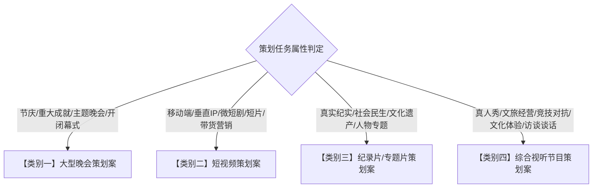

# 策划案实务与高分写作技能指南（策划案skill）

本技能深度融合了**拖鞋哥MFA节目策划实务课程（全8讲）**的底层理论逻辑与**浙江传媒学院（浙传）80份实战策划方案**的最新工业级视听范式，专为广播电视编导、新媒体视听策划、影视制作立项及考研策划答题提供标准化模板与创作规范。

---

## 一、策划案核心类别判定与适用场景

当接收到策划案撰写或评估需求时，首先判定所属类别并套用对应的高精度模板：

---

## 二、策划案五大基本原则与通用七大板块

### 1. 五大基本原则
1. **导向原则**：坚持正确的政治方向、舆论导向和价值引领，社会效益第一。
2. **心理原则**：深度契合受众心理诉求、情感共鸣与分众审美习惯。
3. **创新原则**：在切入视角、机制规则、叙事语态、舞美与视听技术上寻求差异化。
4. **效益原则**：统筹社会效益与商业价值，注重产业长尾赋能。
5. **时间编排原则**：结合受众作息、排播周期、收视峰值及季节时令科学编排。

### 2. 通用七大骨架板块
- **一、背景与动因**：政策背景 + 时代与市场现状 + 受众心理痛点 + 承上启下立项句。
- **二、受众与定位**：核心受众精细画像 + 边缘受众 + 类型定位 + 风格定位。
- **三、宗旨与内涵**：核心宗旨 + 文化内涵 + 精神引领。
- **四、本体与形式**：播出基础（平台/时段/时长）+ 核心机制 + 环节时序推进。
- **五、摄制与工程**：空间设计 + 灯光工程 + 工业级多机位调度 + 视听包装。
- **六、宣推与运营**：全生命周期推广（播前/播中/播后）+ 台网跨屏 + 商业变现。
- **七、保障与预案**：团队架构 + 预算清单 + 政策合规 + 应急控制预案。

---

## 三、四大核心策划案标准模板骨架

### 【类别一】大型晚会策划案标准模板
1. **标题**：《【自拟晚会名称（带书名号）】——【活动全称】》策划案（居中、带“策划案”）
2. **一、主题阐释与立意**：主题名称、Slogan、精神内核、预期社会引领效应
3. **二、晚会背景与目的意义**：国家战略背景、时代节点、晚会目的、**承上启下发起句**
4. **三、晚会基本信息与组织架构**：晚会定位、受众分析、播出平台矩阵、播出时间及重播、**晚会时长（规范用分钟）**、**演出/直播地点（具体到场馆全称）**、组织机构（全称）、组委会架构
5. **四、晚会核心亮点**：时代叙事亮点、视听科技亮点（XR/裸眼3D/全息）、跨屏互动亮点
6. **五、晚会主持人与演职人员配置**：主持人阵容（4~6人，持证专业主持人）、演职人员德艺双馨规范
7. **六、晚会整体流程与节目单架构**：
   - 篇章化推进（序幕 + 3~4个核心板块 + 尾声，共10~12个节目）
   - 每个节目列明：序号 / 节目名称 / 形态 / 演职人员 / 时长 / 视听设计简析
   - 穿插特别致敬/表彰环节
8. **七、主持人串词设计与核心台词示范**（核心加分板块）：
   - 开场联袂串词（宏大破题、扣题点题）
   - 篇章过渡串词（承上启下、情感递进）
   - 致敬环节采访串词（有温度、深挖掘、真共鸣）
   - 尾声谢幕串词（主旨升华、气势磅礴）
9. **八、舞美空间与视听工程设计**：舞台造型、灯光系统（基础光+效果光）、音频扩声、转播机位调度（天轨/摇臂/主机/全景）
10. **九、晚会筹备与全流程执行推进表**：五阶段全生命周期推进
11. **十、全媒体宣传推广方案**：预热期、直播期、长尾期
12. **十一、商业合作与经费预算清单**：赞助模式、预算明细表（800万~1000万元区间）
13. **十二、安全保障与突发事件应急预案**：人员疏导、双路供电与信号热备、舆情预案

---

### 【类别二】短视频策划案标准模板
1. **标题**：《【自拟短视频IP/栏目名称】》短视频项目策划案
2. **一、项目背景与可行性分析**：时代政策背景、微传播与碎片化媒介特征、痛点分析、落地可行性
3. **二、账号定位与核心基本盘**：账号名称、头像与视觉风格、简介Slogan、垂直属性、画幅（竖屏9:16/横屏16:9）、目标用户分层画像
4. **三、内容规划与子专题矩阵**：更新频次（单支1~3分钟以内）、3~4个垂直子专题（主题/主角/看点）
5. **四、单支视频创意分镜头脚本**（核心实操）：
   - 六栏标准分镜表：`镜号` | `景别与运镜` | `画面内容与调度` | `声音设计（解说/对白/音效）` | `音乐BGM` | `时长`
   - 遵循“黄金前3秒抓人原则”与“结尾CTA行动呼吁”
6. **五、视听包装与制作规范**：封面规范、花字动效、音效打点、拍摄器材标准
7. **六、多平台分发与运营增长策略**：跨平台矩阵（抖音/快手/视频号/B站/小红书）、排播时段、互动引流
8. **七、商业变现与价值转化路径**：广告软植入、电商带货/助农橱窗、文创与知识付费
9. **八、团队编制与成本预算**：人员架构、单季预算明细
10. **九、风控机制与注意事项**：真实性审查、版权合规、舆情应对

---

### 【类别三】纪录片 / 专题片策划案标准模板
1. **标题**：《【片名（带书名号）】》【系列人文/社会纪实】纪录片（专题片）策划方案（注明单集或系列及集数）
2. **一、选题分析与创作动因**：时代背景、社会现实痛点与大众情感、坚持“以小见大、从小人物切入”
3. **二、创作理念与核心立意**：宗旨立意、**在真实性基础上严格遵循“五化”黄金法则**（纪录片故事化、故事情节化、情节细节化、细节人物化、人物命运化）、人物画像矩阵
4. **三、形态设置与播出概况（核心五定）**：片名释义、片种类别、体量（总集数+单集时长，严禁使用“期”）、平台与编排、受众分层
5. **四、整体内容框架与分集规划**：叙事主线逻辑、各分集诗意独立标题与故事梗概
6. **五、拍摄大纲与单集调研深描**（核心实操）：
   - 典型分集人物小传、调研基础
   - 段落式四段推进：开篇悬念 $\rightarrow$ 发展寻根 $\rightarrow$ 深入交锋 $\rightarrow$ 结尾升华
   - **深度采访提纲**（必须包含5~8个层层递进、具有人情味与思辨性的具体问句）
7. **六、视听语言与美学风格设定**：
   - 摄影手法（长镜头、空镜头、构图美学）
   - **解说词撰写规范**（声画对位、多用客观指示代词“这/这里”、凝练口语化、严禁主观夸张、见好就收）
   - 声音层次（同期声主导、配乐克制留白）
8. **七、摄制全流程周期规划与团队架构**：四大阶段（调研/实拍/补拍/后期，拍摄时间必须为未来时间）、团队定岗
9. **八、全媒体宣发与长尾传播策略**：播前造势、播中跨屏切片、播后节展巡展
10. **九、成本预算明细与法务合规保障**：预算明细、版权与肖像权合规
11. **十、安全风控与应急预案**：外景安全、素材多地双重备份、替代人物备选方案

---

### 【类别四】综合视听节目策划案标准模板（含真人秀/文旅/文化/竞技/服务/谈话）
1. **标题**：《【自拟节目名称（带书名号）】》【节目形态属性】策划案（副标题注明属性，如：大型文旅体验真人秀）
2. **一、节目核心信息概览**：节目名称、Slogan、类别属性、**体量（季播期数+单期时长，量词规范用“期”）**、播出平台时段、受众分层画像
3. **二、节目背景与策划动因**：主流大政方针引领、市场同质化痛点、受众心理洞察、**承上启下立项句**
4. **三、节目宗旨与核心立意**：社会效益优先、文化传承与时代精神
5. **四、节目核心特色与创新维度**：核心机制创新（规则体系）、叙事年轻化语态、高新视听技术（XR/AI/5G）、**星素结合机制**（明星学徒/探访，素人大师主导）
6. **五、角色设置与核心阵容配置**：常驻MC/嘉宾、飞行嘉宾、专家顾问团/素人大师、主持人/主理人定位
7. **六、核心任务规则与赛制机制**：规定情境目标、推进博弈规则、奖惩激励机制（挂钩公益/文旅）
8. **七、整体季播脉络与单期全流程执行方案**：
   - 全季主题演进地图
   - 典型单期时序推进（集结任务15min $\rightarrow$ 探寻行动35min $\rightarrow$ 体验攻坚30min $\rightarrow$ 展演升华15min）
9. **八、主持人 / 主理人串词设计与核心台词示范**（核心加分板块）：
   - 开篇先声夺人串词（设疑引入、破冰、任务发布）
   - 推进转场与规则解说串词（串联剧情、悬念推进）
   - 深度对谈/交锋引导串词（递进式发问、现场金句提炼）
   - 单期结语升华金句串词（情境留白、主旨拔高、下期预告）
10. **九、摄制策略与工程技术规范**（大题拉开分差硬核板块）：
    - 舞美空间规划、灯光系统与色彩美学
    - **工业级十机位调度方案**（1/3主机特写、2/4全景环境、5/6反打观众、7/8/9游机抓突发、10大臂摇臂/航拍）
    - 剪辑节奏与花字特效包装
11. **十、全生命周期宣传推广策略**：蓄水期、爆发期、发酵期
12. **十一、商业植入与产业衍生闭环**：赞助模式、文旅赋能转化、文创周边开发
13. **十二、组织架构编制与经费预算**：团队定岗、预算清单（1500万~3000万元区间）
14. **十三、广电政策合规与应急保障**：广电总局政策合规（破除唯流量论、抵制泛娱乐化）、安全防范与舆情预案

---

## 四、主持人串词与解说词创作三大黄金法则

1. **角色与站位情境前置**：
   - 串词前必须用方括号标注主持人的**舞台动线、神态肢体、环境声画与LED大屏配合**，营造身临其境的现场感。
2. **结构分工与台词梯次推进**：
   - **晚会串词**：`宏观破题` $\rightarrow$ `篇章承上启下` $\rightarrow$ `典型人物深挖` $\rightarrow$ `尾声合声升华`。
   - **节目主理人**：`先声夺人发任务` $\rightarrow$ `规则通俗化阐释` $\rightarrow$ `冲突反思提炼金句` $\rightarrow$ `总结升华带下期`。
3. **语言对仗工整，多用时代短句与人文金句**：
   - 开头善用排比对仗，强化气势；结尾避免空洞喊口号，以生活化细节或哲理反思收束。

---

## 五、考研应试与方案评审八大避雷军规

| 维度 | ✅ 规范加分项 | ❌ 常见扣分雷区 |
|:---|:---|:---|
| **标题格式** | 《【自拟名称】》——【类别】策划案（居中、书名号、“策划案”字样齐全） | 漏书名号、无个性名称、漏写“策划案”字样 |
| **术语与量词** | 综艺节目严格用**“期”**；纪录片/剧集才用**“集”** | 综艺通篇写“第一集”、“每集” |
| **场地术语** | 直播用**“直播场地”**；录播用**“录制地点”**；具体到场馆/演播大厅全称 | 泛写“北京”、“电视台演播室” |
| **时长表述** | 统一规范表述为具体分钟数（如**“90分钟”**、**“120分钟”**） | 写“1个半小时”、“两小时左右” |
| **提纲设问** | 谈话/访谈提纲必须以具体的**3~5个递进式问句（带问号）**呈现 | 写成陈述句或只列“1.提问 2.回答 3.总结” |
| **文风用词** | 客观中立、严谨规范、富有专业视听术语 | 出现**绝对化广告禁用词**（“顶级、唯一、首创”）或**贬低同类** |
| **规则具象** | 任务关卡写明具体内容、考核标准、惩罚与奖励规则 | 泛谈“嘉宾进行游戏”、“完成挑战”等空洞套话 |
| **政策合规** | 贯彻广电办发〔2021〕267号文：星素结合、抵制泛娱乐化、严审演职人员 | 策划采访劣迹艺人、偶像养成打榜、过度娱乐化 |

---

## 六、参考资料库索引

本 Skill 目录下包含以下完备的拓展参考文档：
- [`01_拖鞋哥策划案核心理论与种类框架.md`](references/01_拖鞋哥策划案核心理论与种类框架.md)：拖鞋哥8讲知识全景、12类节目特征与真题图谱。
- [`02_四大类策划案高精度蒸馏模板全集.md`](references/02_四大类策划案高精度蒸馏模板全集.md)：四大类别的完整可编辑模板文本。
- [`03_主持人串词与解说词高分创作指南.md`](references/03_主持人串词与解说词高分创作指南.md)：解说词七大法则、串词台词示范库与实操案例。
- [`04_考研与实务避坑八大军规与参数库.md`](references/04_考研与实务避坑八大军规与参数库.md)：机位调度库、灯光工程参数、预算科目表与政策红线速查。
