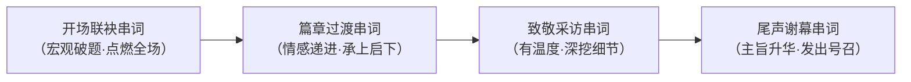

# 主持人串词与纪录片解说词高分创作指南

在影视与广播电视策划案答题及实际方案评审中，**主持人串词**与**纪录片解说词**是体现创作者文字功底、声画思维与文风底蕴的核心得分点。

---

## 第一部分：主持人串词创作法则与实战台词库

### 一、主持人串词的四大节点与结构进阶

#### 1. 晚会主持人串词体系

- **开场联袂串词**：通常为四人搭档（两男两女）。
  - **男主持A**：开篇破题，勾勒宏观时代大背景与历史坐标（如：“这是砥砺奋进的壮阔征程……”）。
  - **女主持B**：点明今晚晚会主题，向全国观众与全场嘉宾致以热烈问候。
  - **男主持C**：提炼晚会精神内核，阐述篇章架构（“今夜，我们以星光为笔，以汗水为墨……”）。
  - **女主持D**：介绍指导主办机构，点燃现场激情。
  - **四人齐声**：合声高呼晚会核心Slogan，引出首个开场大型节目。

- **篇章过渡串词**：拒绝报幕式套话（“请欣赏下一个节目……”）。
  - 必须采用**“回眸上一段情绪 + 提炼精神转折点 + 开启下一篇章宏大命题”**的三段式过渡。

- **致敬采访串词**：
  - 严禁空洞赞美，必须**从微观细节入手**（如：“当年在零下三十度的戈壁滩上，您怀里紧紧护着的那张图纸……”）。
  - 追问精神原动力，引导受访嘉宾说出具有社会感染力的质朴心声。

- **尾声谢幕串词**：
  - 总结全场精彩，抒发对时代复兴的崇高敬意。
  - 面向全体演职人员与观众致谢，发出奋进新时代的强力号召。

---

#### 2. 综合视听节目/真人秀主理人串词体系
- **开篇先声夺人**：以极具悬念的人文问句破题，交代规定情境，发布本期核心任务卡。
- **规则与博弈转场**：用通俗口语化语言交代任务考核指标与倒计时，制造适度紧张感。
- **深度交锋与反思**：在嘉宾遭遇挫折或完成作品后，围坐对谈，深情提炼人生哲学与时代思考。
- **结语升华留白**：2~3句朗朗上口的金句定格，带出下期悬念。

---

### 二、串词写作三大黄金军规

1. **情境与动线必须前置**：
   - 串词前必须用方括号标注主持人的舞台站位、肢体状态、背景声画配合。
   - 例：*【男主持A激昂迈步走至舞台中区，背后LED呈现历史卷轴特效，雄浑交响乐渐弱】*。
2. **拒绝大白话与口水话**：
   - 善于使用四字成语、对仗句与时代新词（如“踔厉奋发”、“赓续文脉”、“破壁出圈”）。
3. **前呼后应**：
   - 串词中承诺的视听奇观或精神内核，必须与后文具体的节目单和看点紧密契合。

---

## 第二部分：纪录片解说词撰写核心规范（第七讲）

### 一、解说词的三大核心作用
1. **弥补画面不足**：补足画面无法展现的背景历史、心理活动或抽象逻辑。
2. **增强画面内涵**：提炼升华主题，深化视觉意境，赋予画面文化底蕴与哲思。
3. **具备转场功能**：利用语意承上启下，实现不同时空、人物、事件之间的无缝衔接。

---

### 二、解说词撰写七大黄金法则

1. **辩证声画关系**：
   - 遵循**“声画对位、声画互补”**原则。画面已表达清楚的内容（如红衣服、正在跑），解说词绝不重复描述，严禁声画同步的文字废话。
2. **多用客观指示代词**：
   - 多用“这”、“这里”，增强纪实感、现场感与带入感。
3. **严禁虚假夸张**：
   - 杜绝假大空的煽情与不合逻辑的形容词堆砌，以客观事实说话。
4. **故事化叙述**：
   - 用讲故事的口吻带出信息，避免公文式说教与政治口号式灌输。
5. **紧扣细节事实**：
   - 巧用具体的数字、具体的动词与微观环境描写（如“凌晨四点零三分”、“手掌上三道深深的茧子”）。
6. **凝练且口语化**：
   - 避免复杂长难句，以短句为主，便于播读和听觉接收。
7. **审慎对待专有名词**：
   - 少用晦涩生僻词；涉及网络热词必须加双引号并予以必要注释。

---

### 三、解说词经典结构与写作技法

- **开头写法**：
  - 平铺直叙开门见山（“北纬三十度的崇山峻岭中，藏着一种世代相传的香气……”）
  - 设疑提问激发好奇（“一个人，究竟需要走过多少里山路，才能把一块顽石变成传世的青花？”）
  - 比喻拟人营造意境（“时间是这里最好的酿酒师……”）
- **主体写法**：
  - 客观叙述 + 纪实对话 + 主人公自述穿插 + 同期声自然切入。
- **结尾写法**：
  - **见好就收，留有余味**；情境描述画龙点睛；首尾呼应升华主旨，切忌画蛇添足的大段口号。
